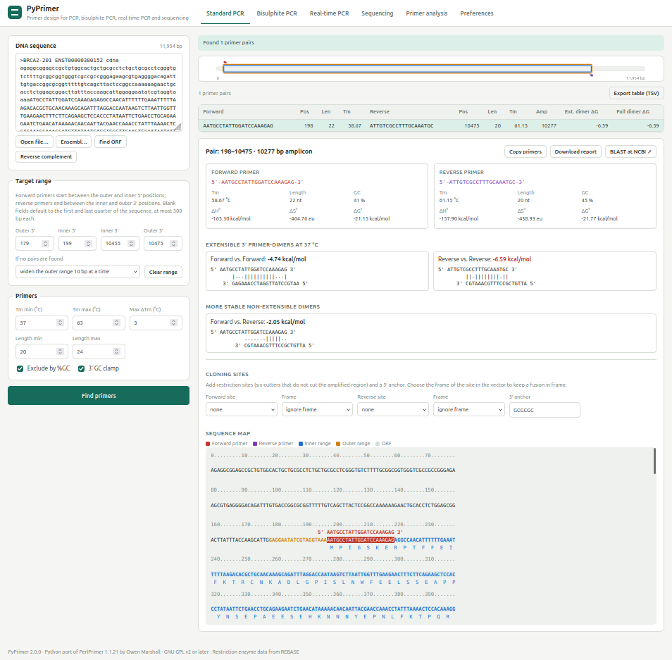
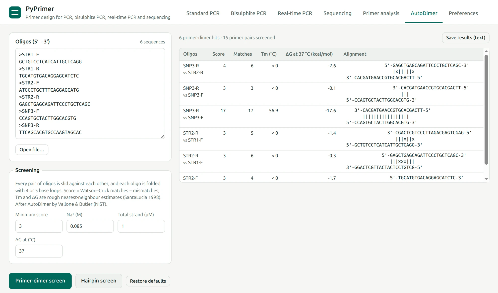

# PyPrimer

Design PCR primers in your browser: standard PCR, bisulphite PCR, real-time
PCR (qPCR) and sequencing, plus primer-dimer and hairpin screening of whole
multiplex sets.

Paste a sequence (or fetch one from Ensembl), say where the amplicon should
be, and PyPrimer lists primer pairs that meet your Tm, length and GC
constraints, ranked by how little they dimerise. Click a pair to see its
thermodynamics, dimer alignments and where it sits on the sequence.



PyPrimer is a Python port of [PerlPrimer](http://perlprimer.sourceforge.net/)
1.1.21 by Owen Marshall. If you have used PerlPrimer, the design modes,
settings and results are the same: Tm, ΔH/ΔS, primer-dimers, ORF and CpG
prediction and all four design modes are tested against the original code
and give identical output. What changed is listed under
[Differences from PerlPrimer](#differences-from-perlprimer).

## Contents

- [Getting started](#getting-started)
- [Designing primers](#designing-primers)
- [Checking primers you already have](#checking-primers-you-already-have)
- [Screening a multiplex set (AutoDimer)](#screening-a-multiplex-set-autodimer)
- [Preferences](#preferences)
- [Command line](#command-line)
- [Differences from PerlPrimer](#differences-from-perlprimer)
- [For developers](#for-developers)
- [Licence and credits](#licence-and-credits)

## Getting started

You need Python 3.10 or later. Install PyPrimer into a virtual environment
and start the web interface:

```bash
git clone git@github.com:chris-mbiomics/pyprimer.git
cd pyprimer
python3 -m venv .venv
.venv/bin/pip install -e '.[server]'
.venv/bin/pyprimer serve --open
```

`--open` launches your browser at http://localhost:8000. Stop the server with
Ctrl+C. Use `--port` to pick another port.

PyPrimer runs entirely on your own machine. It only goes online when you ask
it to: fetching a sequence from Ensembl, or opening NCBI BLAST for a primer
pair. By default it is reachable only from your own computer. To share it on
a lab network, start it with `--host 0.0.0.0`, but only on a network you
trust: there is no login.

## Designing primers

The first four tabs each design primers for one kind of experiment. They all
work the same way:

1. **Load a sequence** into the box on the left: paste it (plain or FASTA),
   use *Open file…*, or click *Ensembl…* to fetch cDNA, CDS or genomic
   sequence by gene symbol or Ensembl ID.
2. **Set the target range**, i.e. where the primers may sit. Forward primers
   start between *Outer 5′* and *Inner 5′*; reverse primers end between
   *Inner 3′* and *Outer 3′*. Leave the fields blank to use the first and last
   quarter of the sequence (at most 300 bp each), or click *Find ORF* /
   *Find CpG islands* to target the longest ORF or CpG island.
3. **Set the primer constraints** (Tm range, maximum Tm difference, length)
   and click **Find primers**.
4. **Pick a pair** from the results table. Pairs are sorted by primer-dimer
   ΔG, least stable dimers first. The detail panel shows each primer's Tm,
   length, GC, ΔH/ΔS/ΔG, the predicted 3′-extensible and other stable dimers,
   and a sequence map with the primers, target range and ORF translation.

If no pair fits, PyPrimer can keep trying on its own: under
*If no pairs are found*, choose to widen the outer range or narrow the inner
range 10 bp at a time, or to stop.

From a result you can *Copy primers*, *Download report* (plain text),
*Export table (TSV)* for a spreadsheet, or *BLAST at NCBI* to check
specificity. Wide target ranges give many candidate pairs and take
correspondingly longer.

### Standard PCR

Primer pairs flanking your region of interest. Under *Cloning sites* you can
add a restriction site and a 5′ anchor to each primer. PyPrimer only offers
six-cutters that do not cut inside the amplicon (from REBASE), and can keep
the site in frame with a fusion in your vector.

### Bisulphite PCR

Primers for bisulphite-converted DNA. Primers are designed against the
converted strand, so they amplify only converted template. Paste the
unconverted genomic sequence; *Find CpG islands* highlights predicted islands
and sets the target range from them. Tick *Exclude CpGs* to reject primers
containing CpG sites; otherwise up to two are allowed and made degenerate
(Y in forward, R in reverse primers) so methylated and unmethylated
templates amplify alike.

### Real-time PCR

Primers for qPCR on cDNA that avoid amplifying genomic DNA, by making the
amplicon span an exon–exon junction or by placing a primer across one.
PyPrimer needs to know where the exon junctions are in your mRNA. Either:

- **Ensembl…** fetches the transcript and fills in the junctions for you;
- type the mRNA positions where each exon after the first begins
  (e.g. `182, 330, 517`); or
- paste the matching genomic sequence under *Map from a genomic sequence*
  and click *Map exon boundaries*.

Set the amplicon size range and whether the amplicon or a primer must span
a junction, then click *Find primers*.

### Sequencing

A tiled set of forward sequencing primers along the sequence, one every
500–700 bp by default (*Spacing min/max*). Set *Start* and *End* to cover
only part of the sequence, or click *Find ORF* to cover the longest ORF.
*Exclude self-dimers* drops primers that pair stably with themselves.

## Checking primers you already have

The **Primer analysis** tab takes one or two primers and reports Tm,
length, GC, ΔH/ΔS/ΔG and every predicted primer-dimer, using the reaction
conditions from *Preferences*. Use it to check primers from a paper or an
older design before ordering.

## Screening a multiplex set (AutoDimer)

When several primer pairs go into one reaction, every primer can dimerise
with every other. The **AutoDimer** tab checks a whole set at once.



1. Paste the oligos, 5′→3′, one per line. Label them with FASTA-style
   `>name` lines so the results are readable. *Open file…* loads a text or
   FASTA file.
2. Click **Screen for dimers and hairpins**. Every pair of oligos, and each
   oligo with itself (self-dimers), is slid against each other, and each
   oligo is folded on itself to look for hairpins.
3. Primer-dimers and hairpins are listed in separate tables. Each hit shows
   the oligo(s), the alignment, its score (Watson–Crick matches minus
   mismatches), and rough Tm and ΔG estimates. *Save results (text)*
   downloads the full report.

*Min. dimer score* and *Min. hairpin score* set how strong an interaction
has to be before it is reported. For primer-dimers the default is 7; 7–8 is
a sensible cut-off for multiplex PCR primers, while a low value such as 3
lists nearly every weak interaction. Hairpin stems are short, so the hairpin
default is 4. If a screen finds nothing, *Try a lower score* reruns it with a
lower threshold. Na⁺, strand concentration and the ΔG temperature only
affect the Tm and ΔG estimates.

This is a port of AutoDimer by Vallone & Butler (NIST). Primer-dimer results
match the NIST web service exactly; see [AutoDimer details](#autodimer-details)
for how it works and where it differs.

## Preferences

The **Preferences** tab holds settings shared by all tabs:

- **Reaction conditions**: primer, Mg²⁺, Na⁺/K⁺ and dNTP concentrations, and
  the temperature for dimer ΔG. Tm uses SantaLucia (1998) nearest-neighbour
  parameters with the Mg²⁺/dNTP salt correction of von Ahsen et al. (2001).
  Set these to match your PCR buffer.
- **Primer filters**: the %GC window used by *Exclude by %GC*, and rejection
  of runs (e.g. AAAAA) and repeats (e.g. ATATATAT), with separate settings
  for bisulphite primers.
- **CpG island prediction**: window size and thresholds for *Find CpG
  islands*.

Preferences are saved in your browser, so they persist between sessions but
are per browser and per computer. *Restore defaults* resets them.

## Command line

Check one or two primers without opening the browser:

```bash
.venv/bin/pyprimer analyse GAGAATGTGGGCTCTCAAGC GGCGTTAGTTTAAGTCACGG
```

Screen a file of oligos (FASTA-style `>label` lines) with AutoDimer:

```bash
.venv/bin/pyprimer autodimer primers.txt --score 7 --hairpin-score 4
```

Run `pyprimer --help` or `pyprimer <command> --help` for all options.

## Differences from PerlPrimer

Intentional changes:

- **Bisulphite reverse primers**: PerlPrimer searched reverse primers for
  `CG` on the reversed (not complemented) top strand. That finds GpC sites,
  not CpG sites, so CpG exclusion and the degenerate `R` bases were applied
  to the wrong positions. PyPrimer checks the real CpG sites. The parity test
  disables this fix to confirm everything else matches.
- **CpG islands** that run to the end of the sequence are now reported
  (PerlPrimer silently dropped them).
- **Default target range**: with no range given, primers are placed in the
  first and last quarter of the sequence, each region at most 300 bp.
  PerlPrimer defaulted to the longest ORF (standard PCR) or CpG island
  (bisulphite); the *Find ORF* and *Find CpG islands* buttons still set the
  range that way. Wide ranges produce many pairs and take correspondingly
  longer.
- **Sequencing** uses its own *Exclude %GC* and *GC clamp* options.
  PerlPrimer showed these checkboxes but applied the Standard PCR settings.
- **Exon mapping**: NCBI Spidey is no longer distributed. PyPrimer aligns the
  mRNA to the genomic sequence itself (exact-match exons, junctions placed
  at GT…AG where the sequence is ambiguous), or takes exon structure from
  Ensembl.
- **Ensembl** is queried through its REST API instead of scraping web pages.
- **BLAST** opens NCBI web BLAST with the primers filled in, rather than
  polling and parsing results inside the application.

Not ported: the Contig Viewer TCP link, `.ppr` project files, local BLAST,
and the *Find primers with cloning* range search. Preferences are stored
per browser.

## AutoDimer details

PerlPrimer had no equivalent of the AutoDimer tab. It ports AutoDimer
(Vallone & Butler, *BioTechniques* 37:226–231, 2004), which screens sets of
multiplex primers for primer-dimers and hairpins. The original Visual
Basic program is distributed only as a compiled binary, so the algorithm was
reconstructed from the paper and calibrated against the web version NIST hosts
at [dnaanalysis.nist.gov](https://dnaanalysis.nist.gov/DNAAnalysis/primer-tools).

- Each pair of oligos, including each oligo with itself, is slid against each
  other, and each oligo is folded with 4- and 5-base loops and stems of at
  least 2 bp. Score = Watson–Crick matches − mismatches; alignments scoring at
  least the dimer or hairpin threshold are reported.
- Tm and ΔG use SantaLucia (1998) unified nearest-neighbour parameters with
  his empirical salt correction (Na⁺ only). Stacks are counted only between
  adjacent matched pairs, and each mismatch adds 0.438 kcal/mol to ΔH. These
  are rough estimates intended for ranking.

Primer-dimer results (alignments, matches, scores, Tm and ΔG) match the NIST
web service exactly, including some of its quirks:

- For oligos of different lengths, overlaps are tried from both ends of the
  shorter oligo. If the longer one is 4 or more bases longer, a few extra
  shifts follow. These compare bases offset by one from where they are drawn.
- Unknown bases (N, ambiguity codes) count as mismatches, and the mismatch
  penalty is not applied to the last position of an alignment.

Deliberate differences from the NIST service:

- **Self-dimers** are screened, as in the original program (the paper counts
  (n² + n)/2 comparisons for n oligos). The NIST web service skips them. A
  self-dimer's full overlap is listed once.
- Primer-dimers and hairpins are screened together, with separate score
  thresholds. NIST runs them separately with one threshold.

- If the longer oligo is at least 2n + 3 bases (n = shorter length), NIST
  reports an error. PyPrimer caps the extra shifts instead.
- Lower-case bases are read as upper case. NIST never pairs them. U is read as T.
- **Hairpin Tm and ΔG** follow the paper: stem duplex plus a 5.6 kcal/mol
  (entropic) loop penalty, Tm = ΔH/ΔS. The values NIST reports for hairpins
  could not be reproduced. Hairpin folds, matches and scores match NIST, except
  where NIST sizes a stem wrongly next to ambiguity codes.
- The paper's own example (Figure 3) gives Tm 7.5 °C and ΔG −2.42 kcal/mol for
  the VB program, versus 4.0 °C and −1.89 kcal/mol here and on the NIST site.

## For developers

### Using PyPrimer as a Python library

```python
from pyprimer.design import design_pcr, Search
from pyprimer.thermo import Conditions, melting_temperature

melting_temperature("ACGTACGTAGCTAGCTAGGA", Conditions(mg_mm=2.0))

result = design_pcr(open("gene.fa").read(), search=Search.OUTWARDS)
for pair in result.pairs[:5]:
    print(pair.forward, pair.reverse, pair.amplicon, pair.dimer_dg)
```

### Project layout

```
src/pyprimer/
  sequence.py    parsing, complementation, composition, genetic code
  thermo.py      nearest-neighbour tables, Tm, dG, reaction conditions
  dimer.py       primer-dimer prediction and diagrams
  features.py    ORF and CpG island detection
  design.py      PCR, bisulphite, qPCR and sequencing primer design
  cloning.py     REBASE parsing and cloning tails
  exons.py       mRNA-to-genome exon mapping (replaces Spidey)
  ensembl.py     Ensembl REST client
  report.py      primer analysis, sequence maps, text reports
  autodimer.py   AutoDimer primer-dimer and hairpin screening of oligo sets
  cli.py         command-line entry point
  web/           Flask app factory, JSON API, template and static assets
  data/gcg.603   REBASE restriction enzyme database
tests/           unit, API, PerlPrimer and NIST AutoDimer parity tests
tools/           Perl harness generator and NIST AutoDimer fixture fetcher
```

### Setup and checks

```bash
.venv/bin/pip install -e '.[dev]'
.venv/bin/ruff check . && .venv/bin/ruff format --check .
.venv/bin/mypy
.venv/bin/pytest
```

### Testing

The unit and API tests run anywhere. The parity tests compare this port
against the original Perl code on randomly generated inputs. They extract
PerlPrimer's algorithm subroutines into a headless harness
(`tools/perl_harness.py`), so they need Perl ≥ 5.14 and the original source:

```bash
PERLPRIMER_PL=perlprimer-1.1.21/perlprimer.pl .venv/bin/pytest tests/test_parity.py
```

`tests/test_autodimer_nist.py` replays results recorded from the NIST
AutoDimer web service (`tests/data/autodimer_nist.json`) offline. To record
them again (this sends only the script's synthetic test sequences to NIST):

```bash
.venv/bin/python tools/fetch_autodimer_nist.py > tests/data/autodimer_nist.json
```

## Licence and credits

PyPrimer is free software under the GNU General Public License, version 2
or (at your option) any later version. See [LICENSE](LICENSE).

- Original PerlPrimer © 2003-2011 Owen Marshall.
- Restriction enzyme data from [REBASE](http://rebase.neb.com/).
- AutoDimer: P. M. Vallone and J. M. Butler, National Institute of Standards
  and Technology (NIST).
- Marshall OJ. PerlPrimer: cross-platform, graphical primer design for
  standard, bisulphite and real-time PCR. *Bioinformatics* 2004
  20(15):2471-2472.
